# How record and replay works

This page explains why you would record and replay an agent's LLM calls in tests, where agent-retrace sits in your agent, and what happens on the first run, on every later run, and when the agent changes.

## Why record and replay?

An agent is code that talks to an LLM in a loop: it sends a prompt, the model answers or asks for a tool, the agent runs the tool and sends the result back, and so on until the model gives a final answer. Testing that loop is awkward, because the most important dependency, the model, is a remote, paid, non-deterministic service.

There are three common ways to test an agent:

|                                              | Call the real API every run          | Hand-written mocks of the SDK        | Record once, replay every run |
| -------------------------------------------- | ------------------------------------ | ------------------------------------ | ----------------------------- |
| Same result on every run                     | No: the model can answer differently | Yes                                  | Yes                           |
| Speed                                        | Seconds per LLM call                 | Instant                              | Instant                       |
| Cost per run                                 | Tokens, every run                    | Free                                 | Free after the first run      |
| Needs an API key in CI                       | Yes                                  | No                                   | No                            |
| Responses look like the real provider's      | Yes                                  | Only as good as your mocks           | Yes: they are the real ones   |
| Notices when a prompt or tool schema changes | No                                   | No                                   | Yes, with a diff              |
| Upkeep                                       | None                                 | Rewrite mocks when the agent changes | Re-record with one command    |

Record and replay takes the good parts of both: the test talks to the real API once, every request and response is saved to a file, and from then on the saved responses are served instead. That gives you:

- **Deterministic tests.** A replayed run gets the same model output every time, so a failure means your code changed, not that the model had a different day.
- **Fast, free, offline CI.** No network, no tokens, no API key. In CI (`replay` mode) a call to a [provider host](configuration.md#provider-hosts) that is not in the recording fails the test instead of going out, so it cannot quietly run up a bill. This covers only calls agent-retrace can see: a custom `baseURL` you have not added to `providerHosts`, or a client given its own undici dispatcher, bypasses it (see [Limitations](limitations.md)).
- **Real data, not guesses.** The responses are the provider's own, streaming events included, so the SDK and your parsing code run exactly as they do in production.
- **A regression signal for free.** Every replayed request is compared with the recorded one. If a prompt, a tool, the model or a parameter changes, the test tells you which step changed and shows a diff, much like a snapshot test does for UI output.
- **Reviewable behavior.** Recordings are readable JSON committed next to the tests, so a pull request that changes the agent also shows how its conversation with the model changed.

Tool calls get the same treatment when you wrap them with [`recordTool`](recording-tools.md): a replay returns the recorded result without touching your database, a third-party API or anything else with side effects.

## Where agent-retrace sits

You do not change your agent code or pass a custom client. agent-retrace works below the SDKs, at the HTTP layer: Node's `fetch` sends requests through a global undici dispatcher, and `replay()` puts its interceptor in front of it. (A client given its own dispatcher skips the global one, and with it agent-retrace.) Your own tools are covered by the `recordTool` wrapper.

- Only requests to [provider hosts](configuration.md#provider-hosts) are intercepted: `api.openai.com` and `api.anthropic.com` by default, plus any you add. Add yours for Azure OpenAI, a proxy or gateway, or any other provider you reach through the Vercel AI SDK, or those calls go out unrecorded. Other traffic, such as `localhost` or a test database, goes through untouched.
- Only tools wrapped with `recordTool` are recorded. Unwrapped tools always run for real.
- Everything made inside one `replay()` call belongs to one recording, as an ordered list of steps.

## The first run: recording

When no recording exists yet (and you are not in CI), the test runs live. Each provider call and each wrapped tool call goes to the real thing, and agent-retrace keeps a copy. When the test body finishes, the steps are written to one JSON file before `replay()` returns, so a failed write fails the test.

Before anything is written, API keys and auth headers are stripped and your [redaction rules](configuration.md#redaction) are applied. Transient failures (408, 409, 429 and 5xx responses) are never recorded. When the SDK retries one and succeeds, only the successful call is kept, so a replay is one clean call with no retry delay.

## Every later run: replay

With a recording on disk, the same test runs without the network. Each request the agent makes is matched against the recorded steps, and the recorded response is played back to the SDK, as a stream if it was streamed. Wrapped tools return their recorded result without running.

No provider API and no tool appear in this diagram: that is the point. Once `replay()` returns, the test's own assertions (`expect(result.action).toBe("answer")`) run against the real, recorded model output.

### How a request matches a step

- An LLM step matches on the request's method, full URL and body, after redaction and after removing any [ignored fields](configuration.md#ignored-fields). Of the headers, only `anthropic-version`, `anthropic-beta` and `openai-beta` count; all others (auth, request IDs, SDK versions) are dropped.
- A tool step matches on the tool's name and its arguments.
- A request takes the earliest recorded step with the same match key that has not been used yet. The order in which responses complete does not matter, so agents that run calls in parallel replay correctly.
- When the test body ends, every recorded step must have been used. An agent that now makes fewer calls fails at the first step it skipped, even though each call it did make was served.

## When your agent changes

Say you edit the system prompt of the 6-step `refund-damaged-order` example. The first LLM request no longer matches step 1, so agent-retrace stops there and reports the change instead of a vague "no matching recording":

If the change happens later, say your code now builds the refund reason it passes to `issue_refund` differently, steps 1 to 4 replay normally and the report points at step 5. Either way you get the step number, its type and a diff by meaning: system prompt lines, messages added or removed, tool schemas, model and parameters. See [Modes and change reports](modes.md#what-a-change-report-contains) for the full format.

### Accepting the change: update mode

If the change is intended, run the command printed in the report (`AGENT_RETRACE_MODE=update ...`). Update mode replays everything before the change and only goes live from the changed step onward, so you pay for, and wait for, only the part of the run that is actually different:

Steps 1 to 4 (green) come from the old recording, without calling the API or running any tool. From step 5 on (orange), the agent talks to the real API and runs its real tools, and those steps replace the old steps 5 and 6.

Review the recording's diff in git like any other change and commit it.

## Which mode does what

The mode comes from `AGENT_RETRACE_MODE`, or defaults to `replay` in CI and `auto` locally. When `replay()` starts, for every call the agent makes, and once more when the test body ends, the decision looks like this:

![Decision flowchart: when replay() starts without a recording, every call is recorded live, or in replay mode the test fails with RecordingNotFoundError. With a recording, each call that matches an unused recorded step is served from it; one that does not either goes live and re-records the rest in update mode, or fails with ChangeDetectedError. After the last call, recorded steps left unused are dropped from the recording in update mode and fail with ChangeDetectedError otherwise; with none left, the test passes.](../diagrams/mode-decision.svg)

Recordings only change when you ask for it: a first run with no file, or an explicit `update`. A changed agent never silently overwrites its recording, and in CI no call that agent-retrace intercepts goes out to a provider.
